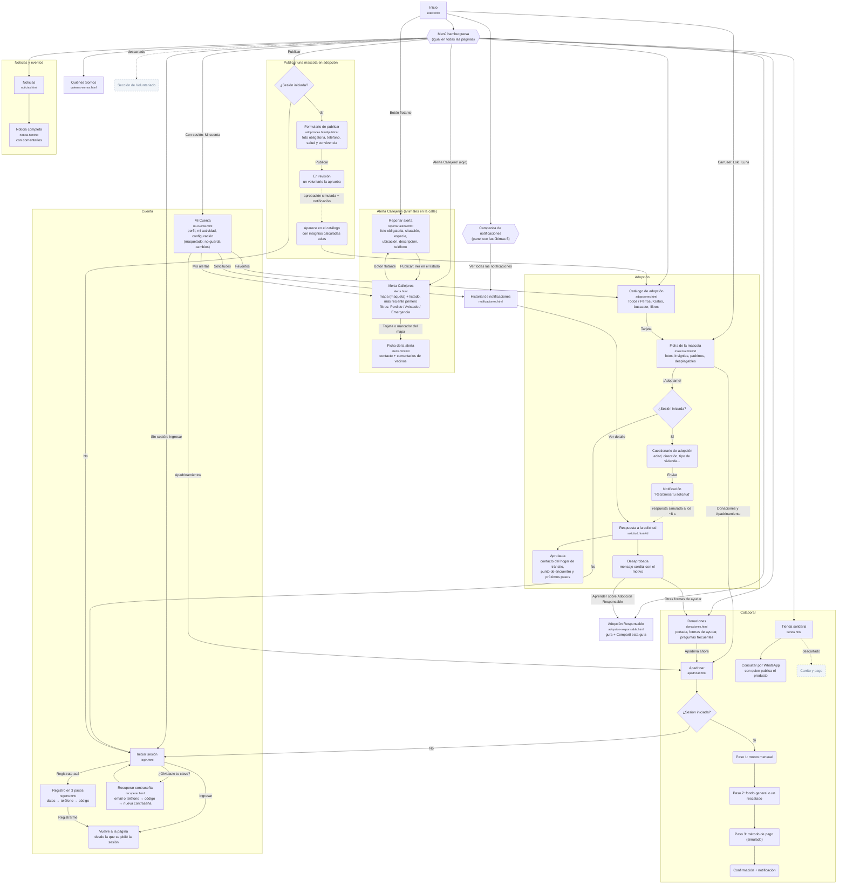

# Diagrama de flujo actual — Callejeros Río Cuarto

Páginas y recorridos principales del sitio tal como está hoy. Reemplaza como referencia al diagrama original hecho en Coggle (`../Callejeros_Ro_IV.png`, en la carpeta de arriba), que se conserva para comparar en la presentación.

**Cómo leerlo**

- Rectángulo: una página del sitio (con su archivo).
- Rectángulo redondeado: un paso o una pantalla dentro de una página.
- Rombo: una decisión (por ejemplo, si hay sesión iniciada).
- Línea punteada: algo que pedía el diagrama original y se descartó a propósito, o un evento simulado que llega solo.

Imagen exportada: `diagrama_flujo_actual.png` (en esta misma carpeta).

El menú hamburguesa, la campanita de notificaciones y el botón "Volver" están en todas las páginas internas, así que el diagrama los muestra una sola vez.

## Cambios respecto del diagrama original

| Diagrama original (Coggle) | Sitio actual |
|---|---|
| Catálogo separado para perros y para gatos | Un solo catálogo con pestañas Todos / Perros / Gatos, buscador y filtros |
| Comentarios en la ficha de la mascota | Sin comentarios en la ficha; quedan en Alertas y Noticias |
| Alerta / Reportes "en desarrollo (ver ideas)" | Sistema propio: listado, mapa (maqueta), ficha con comentarios y formulario de reporte |
| Tienda con carrito y pago | Sin carrito: "Consultar por WhatsApp" con quien publica el producto |
| "Ver de agregar sección de voluntariados" | Descartada: fuera del alcance de la plataforma |
| Login / Registro → Home | Login y registro vuelven a la página desde la que se pidió la sesión; se suman Recuperar contraseña y Mi Cuenta |
| — | Notificaciones (campanita e historial) y respuesta simulada a solicitudes y publicaciones |
