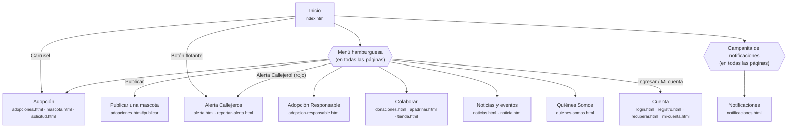
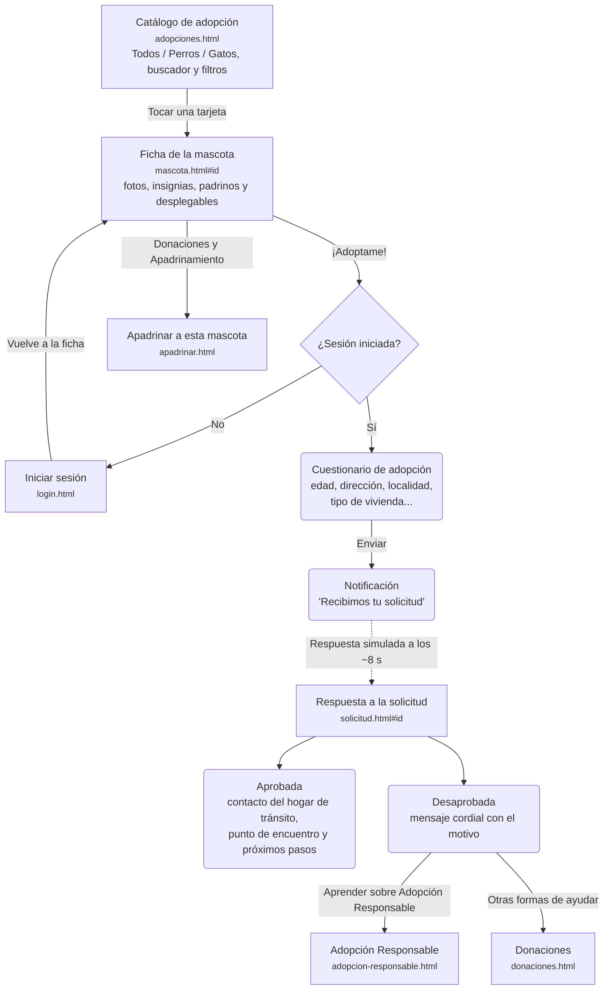
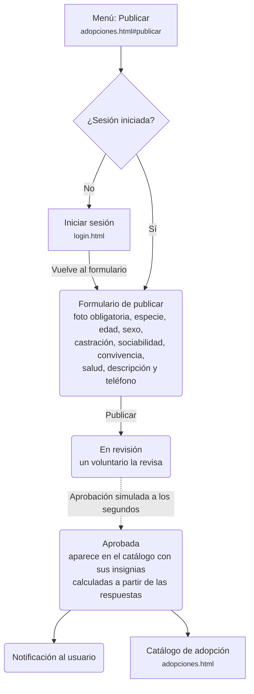
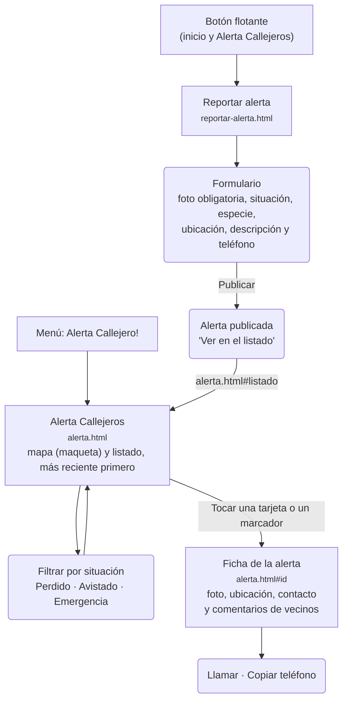
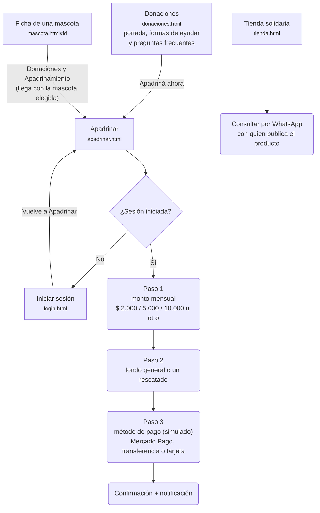
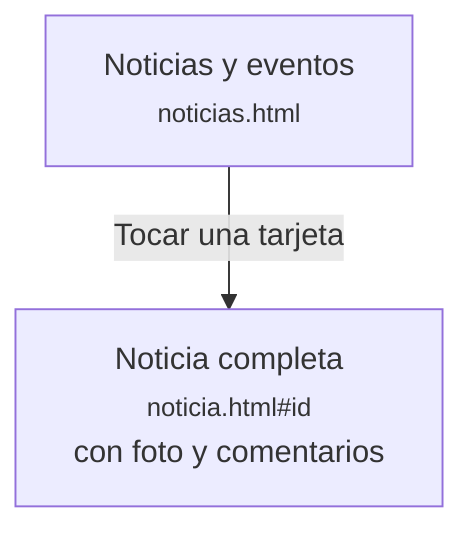
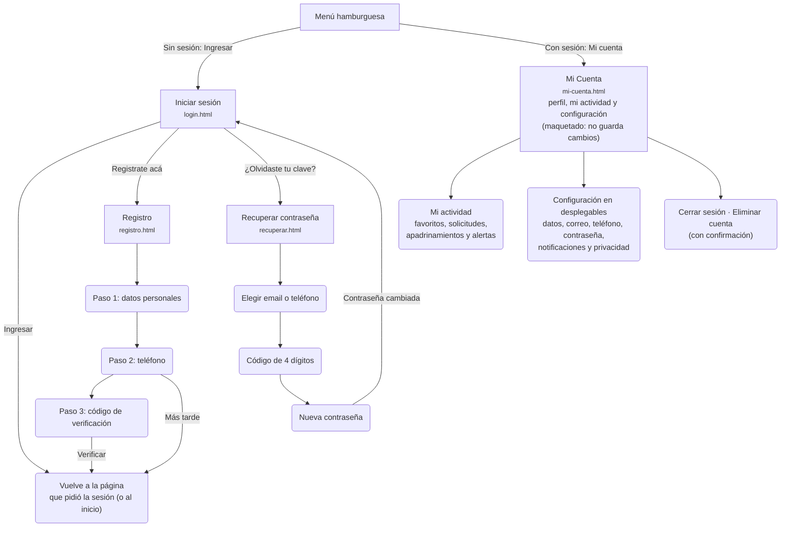
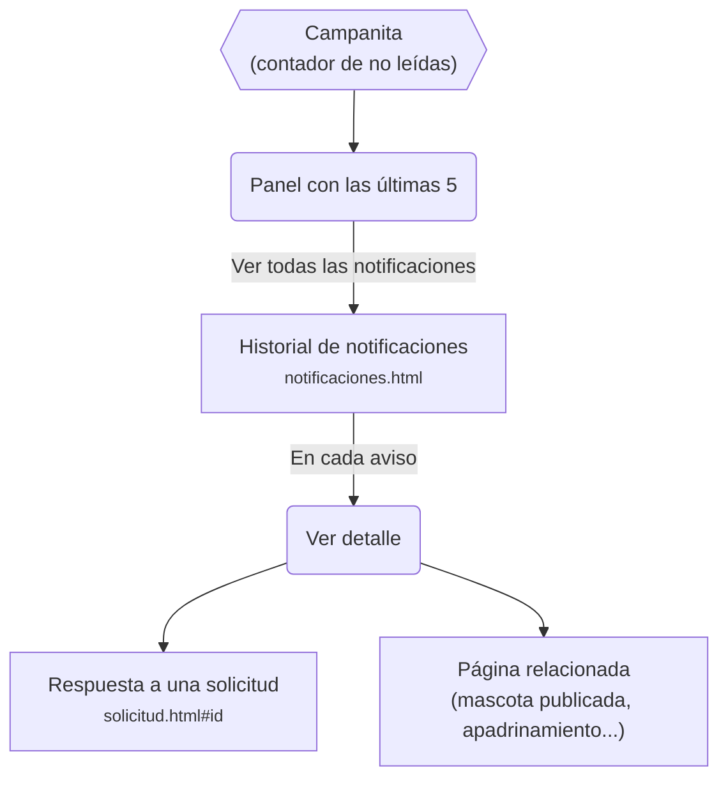

# Diagrama de flujo por recorridos — Callejeros Río Cuarto

Segunda versión del diagrama de flujo del sitio actual: un **mapa general** de las secciones y un **diagrama por cada recorrido principal**. Solo muestra lo que hoy existe en el sitio. La primera versión, en un solo diagrama, es `diagrama_flujo_actual.md`, en esta misma carpeta.

Las imágenes exportadas están en la carpeta `recorridos/`, en esta misma carpeta.

**Cómo leerlo**

- Rectángulo: una página del sitio (con su archivo).
- Rectángulo redondeado: un paso o una pantalla dentro de una página.
- Rombo: una decisión (por ejemplo, si hay sesión iniciada).
- Línea punteada: algo que llega solo, simulado por el prototipo (una respuesta o una aprobación).

---

## 1. Mapa general

Desde el inicio y desde el menú hamburguesa (igual en todas las páginas) se llega a cada sección. La campanita de notificaciones y el botón "Volver" también están en todas las páginas internas.

---

## 2. Adopción

Del catálogo a la ficha de la mascota, el cuestionario y la respuesta simulada de un voluntario.

---

## 3. Publicar una mascota en adopción

Pide cuenta y pasa por la revisión de un voluntario antes de aparecer en el catálogo.

---

## 4. Alerta Callejeros

El seguimiento de los animales que están en la calle. Publicar una alerta no pide cuenta.

---

## 5. Colaborar

Formas de ayudar sin adoptar: donar, apadrinar y comprar en la tienda solidaria.

---

## 6. Noticias y eventos

---

## 7. Cuenta

Iniciar sesión, registrarse, recuperar la contraseña y administrar la cuenta. Cuando otra página pide la sesión, al terminar se vuelve a esa página.

---

## 8. Notificaciones

